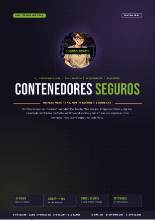
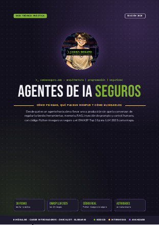

# Cuadernillos de Codea Seguro

Cuadernillos teórico-prácticos gratuitos sobre **arquitectura, programación y seguridad**, con ejemplos de código inseguro vs seguro, actividades y solucionario.

🌐 [codeaseguro.dev](https://codeaseguro.dev)

## Cuadernillos disponibles

### Contenedores seguros

**Buenas prácticas, optimización y seguridad**

De "funciona en mi máquina" a producción: Dockerfiles prolijos, imágenes chicas y rápidas, cadena de suministro confiable, runtime endurecido y Kubernetes sin sorpresas.

- **Nivel:** De principiante a avanzado
- **Temas:** Docker · Dockerfile · Optimización · Cadena de suministro · Kubernetes · OWASP Kubernetes Top 10
- **Edición:** v1.0 · 51 páginas · 3.4 MB

**[📖 Leer online](https://cuadernillos.codeaseguro.dev/contenedores-seguros.pdf)** · **[⬇ Descargar PDF](https://github.com/codeaseguro/cuadernillos-guias/releases/latest/download/contenedores-seguros.pdf)**

 

---

### Agentes de IA seguros

**Cómo piensan, qué pueden romper y cómo blindarlos**

Desde qué es un agente hasta cómo llevarlo a producción: herramientas, memoria, RAG, inyección de prompts y control humano, con código Python inseguro vs seguro.

- **Nivel:** De principiante a avanzado
- **Temas:** Agentes de IA · LLM · Inyección de prompts · RAG · MCP · OWASP LLM Top 10 2025
- **Edición:** v1.0 · 49 páginas · 3.3 MB

**[📖 Leer online](https://cuadernillos.codeaseguro.dev/agentes-ia-seguros.pdf)** · **[⬇ Descargar PDF](https://github.com/codeaseguro/cuadernillos-guias/releases/latest/download/agentes-ia-seguros.pdf)**

 

## ¿Encontraste un error?

Abrí un [issue](https://github.com/codeaseguro/cuadernillos-guias/issues/new) indicando el cuadernillo, el número de ficha (#NN) y qué corregirías. Las correcciones salen en la próxima edición.

## Licencia

- **Contenido de los cuadernillos:** [CC BY-NC-SA 4.0](https://creativecommons.org/licenses/by-nc-sa/4.0/deed.es). Podés compartirlo y adaptarlo citando a Codea Seguro, sin uso comercial y con la misma licencia.
- **Fragmentos de código:** [MIT](LICENSE). Usalos libremente en tus proyectos, incluso comerciales.
- **Marca:** el nombre, el logo y la identidad visual de Codea Seguro no están incluidos en estas licencias.

Detalle completo en [LICENSE](LICENSE).
